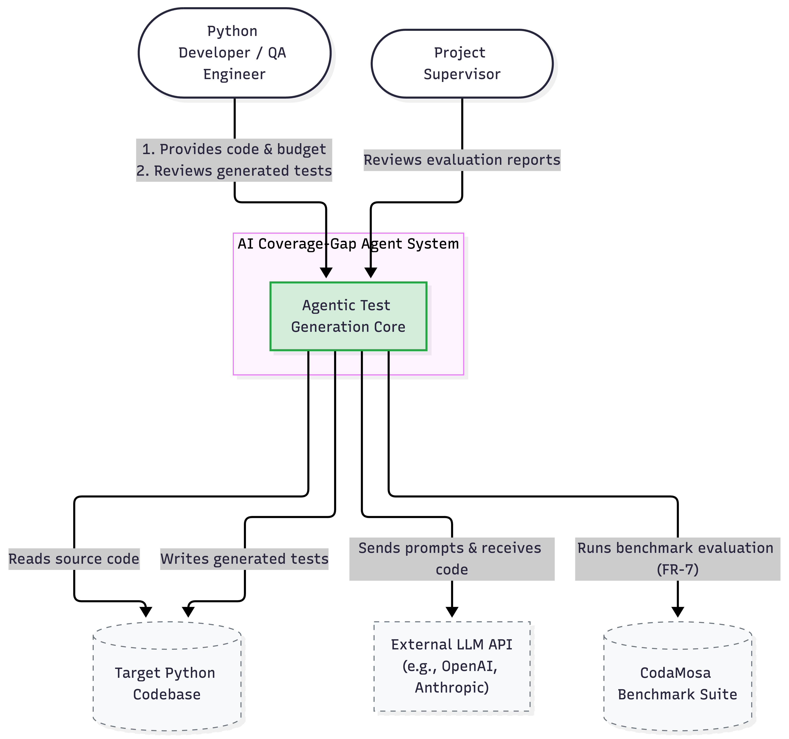
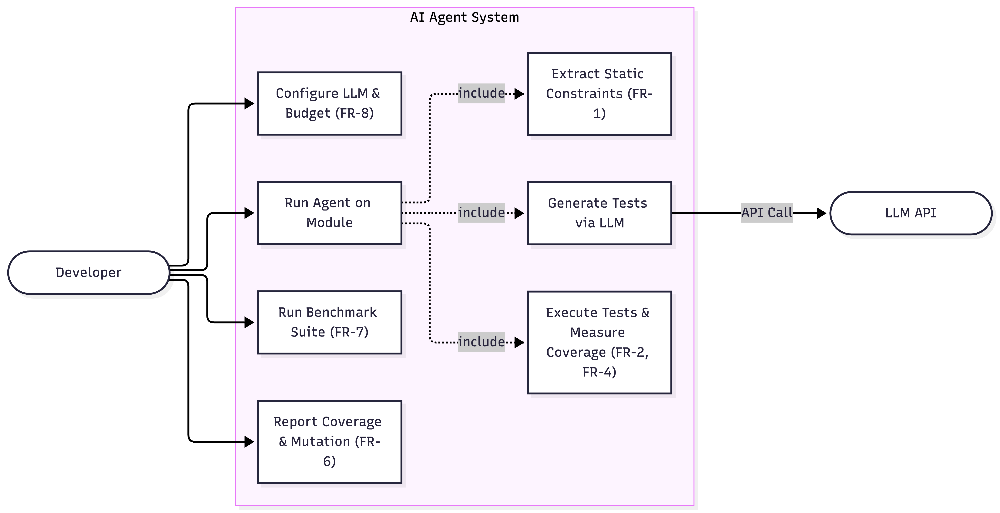
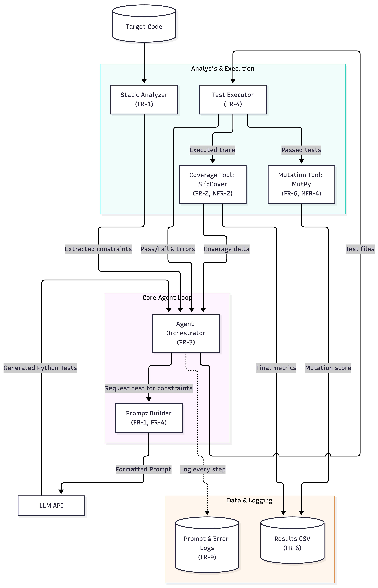

# 7. Architecture and Diagrams

## 7.1 Architectural Overview

The system is designed as an agentic, feedback-driven pipeline that automates Python unit test generation. The architecture is directly based on  the requirements specification (Section 6) and the technology comparison (Section 5). It consists of five main components working in a closed loop.

The design follows a modular architecture to satisfy **NFR-7 (Maintainability)**. The static analysis, LLM interaction, test execution, and coverage measurement are decoupled, so  any component (e.g.,  the coverage tool or the LLM provider) can be replaced  without affecting the core workflow.

The central data flow is:
1. **Analyze:** The agent extracts static constraints (branch conditions, types) from the target code.
2. **Generate:** It constructs a prompt containing these constraints and asks the LLM for tests.
3. **Execute:** It runs the generated pytest files.
4. **Measure:** It calculates the coverage change and checks for execution errors.
5. **Loop:** If coverage improves but does not reach 100%, it feeds the gaps and errors back into the next prompt.

## 7.2 System Context Diagram

The System Context Diagram defines the boundaries of the system, showing who uses it and what external services it relies on. It aligns with the Stakeholders section (Section 6.2) and FR-8 (LLM Configuration).

## 7.3 Use Case Diagram
The Use Case Diagram defines the functional scenarios of the system. These directly address the Functional Requirements (FR-1 to FR-9).

  

## 7.4 Component Diagram 
The Component Diagram shows the internal structure of the system and how data moves between the modules.

  

**Data Flow Alignment:**
- **Static Analyzer:** Takes the target code and outputs constraints to the Orchestrator (FR-1).
- **Prompt Builder:** Takes constraints and previous execution errors to build the prompt (FR-1, FR-4).
- **Test Executor:** Runs the generated code and passes the execution trace to SlipCover (FR-4).
- **Coverage Tool (SlipCover):** Measures the execution trace and returns the coverage delta (FR-2, NFR-2).
- **Mutation Tool:** Runs independently on passing test suites to calculate the mutation score (FR-6, NFR-4).