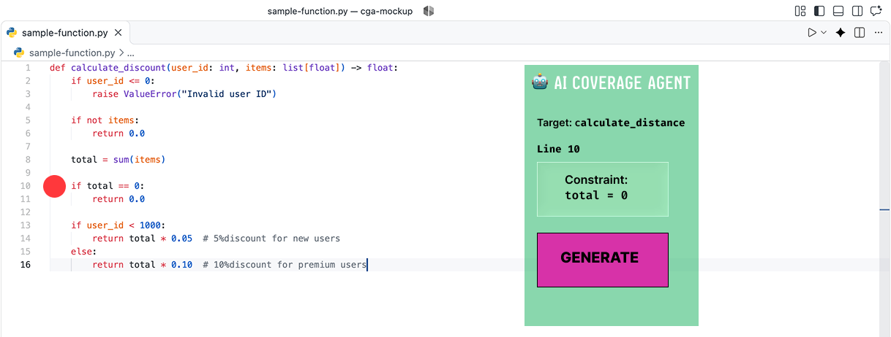

# 8. UX / Prototype

## 8.1 Approach

The proposed system has two interaction layers:
*  a command-line interface (CLI) for the agent core, 
* and a Visual Studio Code (VS Code) extension for the user-facing MVP. 

To evaluate the user experience before full implementation, this section provides concrete examples of the CLI input/output, the JSON data passed between the static analyzer and the LLM, and text-based wireframe mockups of the intended VS Code interface. These materials define how the developer will interact with the AI agent during their normal workflow.

## 8.2 Scenario 1: The VS Code Extension Interface (MVP Mockup)

The VS Code extension is the primary interface for the developer. It is designed to be non-intrusive, surfacing coverage gaps without forcing the developer to leave their editor.

  

*Figure 1: Mockup of the VS Code extension interface. The red dot in the gutter indicates an uncovered branch inside the `calculate_discount` function (Line 10). Clicking it opens the AI Agent sidebar on the right, which displays the extracted constraint (`total == 0`) and provides a button to generate a targeted test.*

## 8.3 Scenario 1: The VS Code Extension Interface (MVP Mockup)